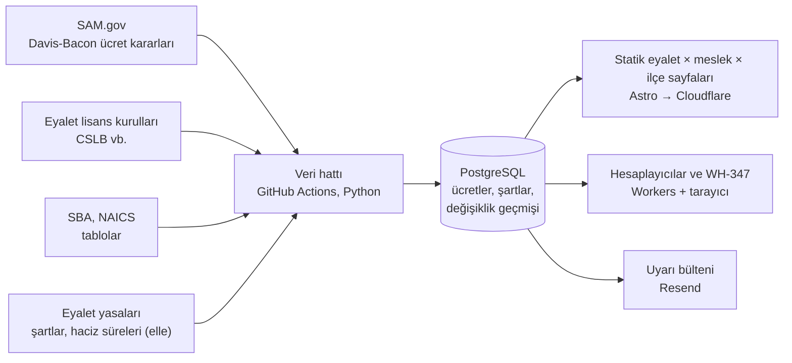

# İnşaat Yüklenicileri Uyum Merkezi — Proje Dokümantasyonu

> AdSense Site #3 · Son güncelleme: 23 Kasım 2026
> Portföy: 5 sektör, 5 ayrı veri motoru. Bu site **inşaat ve yüklenici uyumu** alanında, kendi veri motoruyla çalışır ve diğer sitelerle kod veya veritabanı paylaşmaz.

## Özet

ABD'deki inşaat yüklenicileri ve taşeronlar için İngilizce bir uyum ve evrak merkezi. Bir yüklenicinin iş almak ve kurallara uygun çalışmak için bilmesi gereken her şeyi eyalet, meslek ve ilçe bazında tek yerde toplar:

- lisans şartları ve lisans sorgusu,
- kamu işlerinde asgari ücretler (prevailing wage) ve certified payroll,
- kefalet (bond) ve sigorta maliyetleri,
- federal ihale kaydı (SAM, UEI, NAICS, SBA),
- haciz (lien) süreleri.

**Hedef:** 12–18 ayda aylık 1.000 $ AdSense geliri. Reklam değeri bu portföyün en yükseği olduğundan hedefin aşılma olasılığı da en yüksek.

**Neden kazanır:**
- **Kitle:** Para harcayan küçük ve orta ölçekli işletmeler.
- **Reklamverenler:** Sigorta, kefalet, bordro yazılımı ve ihale platformları. Tıklama başına 15–200 $ ödüyorlar (aşağıdaki tabloya bakın).
- **Veri:** Resmi ve ücretsiz, ama 50 eyalete ve binlerce belgeye dağılmış durumda.

**Çalışma modeli:**
- Teknik altyapıyı ve veri hatlarını Claude kurar.
- Rehberleri yazar ekibi üretir.
- Sahip haftada 4–10 saat yön ve kalite kontrolü yapar.

**Çalışma adı:** Henüz belirlenmedi (bkz. Açık kararlar).

## Talep verisi (Keyword Planner, ABD, Kasım 2025 – Ekim 2026)

Arama sayıları Google'ın aralıklarıdır (B = bin). Tıklama ücreti, "sayfanın üstü teklifi" düşük–yüksek aralığıdır. Kaynak: Google Ads Keyword Planner, plan 1446668480, 23 Kasım 2026.

**Para getiren küme: sigorta, kefalet, bordro**

| Kelime | Aylık arama | Tıklama ücreti | Trend |
| --- | --- | --- | --- |
| general liability insurance for contractors | 1B–10B | 43,33–120,00 $ | Sabit |
| construction payroll software | 100–1B | 36,73–200,00 $ | Sabit |
| certified payroll | 1B–10B | 8,37–95,04 $ | Sabit |
| workers comp for contractors | 100–1B | 17,82–74,60 $ | 3 ayda +%900 |
| contractor insurance cost | 100–1B | 13,44–56,37 $ | +%900 |
| contractor license bond | 100–1B | 14,68–49,34 $ | Sabit |
| construction estimating software | 1B–10B | 8,75–44,81 $ | Sabit |
| bid bond | 1B–10B | 5,91–35,00 $ | Sabit |
| construction bids | 1B–10B | 6,66–30,06 $ | Sabit |
| performance bond | 1B–10B | 5,24–27,49 $ | Sabit |
| certified payroll form wh-347 | 100–1B | 1,79–27,17 $ | Sabit |
| surety bond cost | 100–1B | 2,00–9,54 $ | Sabit |

**Trafik getiren küme: lisans, ücret, kayıt**

| Kelime | Aylık arama | Tıklama ücreti | Trend |
| --- | --- | --- | --- |
| contractor license lookup | 10B–100B | 3,39–15,92 $ | −%90 işareti |
| contractor license california | 10B–100B | 3,00–7,09 $ | Sabit |
| naics code lookup | 10B–100B | 0,02–2,54 $ | Sabit |
| mechanics lien | 10B–100B | 0,73–3,62 $ | Sabit |
| osha 30 | 10B–100B | 2,84–10,54 $ | Sabit |
| osha 10 certification | 10B–100B | 1,71–5,75 $ | Sabit |
| florida contractor license lookup | 1B–10B | 3,90–15,80 $ | Sabit |
| how to get a contractors license | 1B–10B | 0,91–7,35 $ | Sabit |
| general contractor license texas | 1B–10B | 0,34–6,41 $ | Sabit |
| prevailing wage rates | 1B–10B | 2,20–12,91 $ | Sabit |
| davis bacon wage rates | 1B–10B | 1,48–7,59 $ | Sabit |
| sam gov registration | 1B–10B | 2,04–17,35 $ | Sabit |
| uei number lookup | 1B–10B | 2,31–8,26 $ | Sabit |
| cage code lookup | 1B–10B | 1,72–3,57 $ | Yıllık −%90 işareti |
| sba size standards | 1B–10B | 0,40–40,00 $ | Sabit |
| naics code for construction | 1B–10B | 0,71–16,66 $ | Sabit |
| government contracts for small business | 1B–10B | 1,31–6,73 $ | +%900 |
| 8a certification | 1B–10B | 0,63–6,43 $ | Sabit |
| lien waiver form | 1B–10B | 0,77–2,51 $ | Sabit |
| conditional lien waiver | 1B–10B | 0,91–3,15 $ | Sabit |
| retainage | 1B–10B | 0,03–10,55 $ | Sabit |
| preliminary notice california | 100–1B | 1,33–5,18 $ | Sabit |
| contractor license exam | 100–1B | 2,06–6,29 $ | Sabit |

**Strateji:** Trafiği lisans, ücret ve kayıt sayfaları getirir. Ziyaretçiyi oradan sigorta, kefalet ve bordro sayfalarına ve hesaplayıcılarına taşırız; RPM'i bu sayfalar yükseltir.

## Hedef kitle

- **Küçük yüklenici ve taşeron:** Elektrikçi, tesisatçı, çatıcı, HVAC. Başka eyalette iş almak, lisans yenilemek, kamu işine teklif vermek ister.
- **Yeni lisans alacak usta:** "X eyaletinde Y lisansı nasıl alınır, maliyeti ne, sınav ne?" sorularına cevap arar.
- **Kamu işi yapan yüklenici ve bordrocusu:** İlçe bazında asgari ücret ve haftalık certified payroll (WH-347) ihtiyacı var.
- **Federal ihaleye girmek isteyen KOBİ:** SAM kaydı, UEI, NAICS ve SBA büyüklük standardı bilgisi arar.
- **Ev sahibi ve proje sahibi:** Yükleniciyi işe almadan önce lisansını kontrol eder (ikincil kitle).

## Ürün kapsamı: araçlar

| Araç | Ne yapar | Faz |
| --- | --- | --- |
| Lisans şartları rehberi | Eyalet × meslek → hangi lisans, sınav, kefalet tutarı, sigorta şartı, ücretler, resmi başvuru bağlantısı | MVP |
| Lisans sorgusu yönlendirici | Eyalet seç → resmi sorgu sayfasına doğrudan bağlantı + sorgu rehberi. Toplu veri yayınlayan eyaletlerde (ör. Kaliforniya) site içi arama | MVP (yönlendirici), Faz 2 (site içi arama) |
| Prevailing wage bulucu | Eyalet + ilçe + meslek + iş türü → Davis-Bacon saatlik ücret ve yan haklar, kararın numarası ve tarihi | MVP |
| Certified payroll (WH-347) yardımcısı | Ücret kararı + saatler → brüt, fazla mesai, yan hak hesabı; doldurulmuş WH-347 taslağı (PDF) | MVP |
| Kefalet maliyeti hesaplayıcı | Kefalet türü + tutar + kredi notu aralığı → tahmini prim aralığı | MVP |
| Sigorta maliyeti rehberi | Meslek + eyalet → genel sorumluluk ve işçi tazminatı sigortası için tahmini aralıklar | Faz 2 |
| Federal ihale kayıt rehberi | SAM kaydı adım adım, UEI/CAGE açıklaması, NAICS kodu + SBA büyüklük standardı sorgusu | MVP |
| Haciz (lien) süreleri | Eyalet → ön bildirim ve haciz süreleri, feragat formu türleri | Faz 2 |
| Lisans yenileme hatırlatıcısı | Kullanıcı lisansını kaydeder → yenileme tarihinden önce e-posta | Faz 3 |

**Her araçta zorunlu olanlar**

- "Bilgilendirme amaçlıdır" uyarısı ve resmi kaynağa bağlantı.
- Verinin son kontrol tarihi.
- Paylaşılabilir, indekslenebilir sonuç URL'si.
- Kefalet ve sigorta rakamlarında "tahmini aralık" etiketi ve dayandığı varsayımlar.

## Veri kaynakları ve güncelleme

| Kaynak | Kapsam | Erişim | Maliyet | Durum |
| --- | --- | --- | --- | --- |
| SAM.gov Davis-Bacon wage determinations (Çalışma Bakanlığı) | İlçe ve iş türü bazında federal asgari ücret ve yan haklar | Web; belge indirme | Ücretsiz | Kullanılabilir; Mayıs 2026'da biçim değişti, ayrıştırıcı buna göre yazılmalı |
| Eyalet prevailing wage tabloları (ör. Kaliforniya DIR) | Eyalet kamu işleri ücretleri | Web ve dosyalar, eyalete göre değişir | Ücretsiz | Faz 2, eyalet eyalet |
| Kaliforniya CSLB Master List | Lisans no, işletme adı, adres, telefon, durum, tarihler, sınıflar, kefalet ve işçi tazminatı bilgisi | Ücretsiz indirme | Ücretsiz | Kullanılabilir |
| Diğer eyalet lisans kurulları (Florida DBPR, Texas TDLR vb.) | Lisans kayıtları ve şartlar | Eyalete göre: açık veri, indirme, yalnızca web | Çoğu ücretsiz | Eyalet bazında doğrulanacak |
| WH-347 formu ve talimatları (Çalışma Bakanlığı) | Certified payroll formu | PDF | Ücretsiz, kamu malı | Kullanılabilir |
| SAM.gov Entity verisi | UEI, CAGE, kayıt durumu | Toplu çıktı ve API | Ücretsiz, anahtar gerekebilir | Faz 2'de doğrulanacak |
| NAICS (Census) ve SBA büyüklük standartları tablosu | Sektör kodları ve KOBİ eşikleri | Tablo indirme | Ücretsiz | Kullanılabilir |
| Haciz süreleri | 50 eyalet yasaları | Yasa metinleri, elle derleme | Ücretsiz | Faz 2, hukuk editörü kontrolüyle |
| Kefalet ve sigorta fiyatları | Prim aralıkları | Resmi kaynak yok; sektör yayınları ve teklif ortakları | — | Açıkça "tahmin" etiketiyle |

**Güncelleme stratejisi**

1. **Haftalık:** SAM.gov ücret kararlarındaki değişiklikleri (yeni değişiklik numaraları) yakala. Etkilenen ilçe × meslek sayfalarını yenile ve "bu hafta değişen ücretler" sayfası üret.
2. **Aylık:** Toplu veri veren eyalet lisans dosyalarını yeniden indir.
3. **Yılda bir:** 50 eyaletin lisans şartlarını ve haciz sürelerini editör kontrolünden geçir. Yasama dönemi sonrası değişiklik taraması da bu adımda yapılır.
4. Her sayfada "son kontrol" tarihi. 12 aydan eski şart bilgisi uyarı rozeti alır.

## Teknik mimari ve araçlar

| Katman | Araç | Neden | Tahmini aylık maliyet |
| --- | --- | --- | --- |
| Web çatısı | Astro | Statik üretim, hızlı sayfalar | 0 $ |
| Barındırma ve CDN | Cloudflare Pages + Workers | Statik sayfalar, hesaplayıcı ve PDF üretimi | 0–5 $ |
| Veritabanı | PostgreSQL (Supabase veya Neon) | Ücret kararları, lisans şartları, değişiklik geçmişi | 0–25 $ |
| Veri hatları | Python + GitHub Actions | Haftalık SAM.gov, aylık eyalet dosyaları | 0 $ |
| Belge ayrıştırma | pdfplumber / metin ayrıştırıcı | Ücret kararı belgelerinden tablo çıkarma | 0 $ |
| PDF üretimi | Tarayıcıda (pdf-lib) | Doldurulmuş WH-347 taslağı; kullanıcı verisi sunucuya gitmez | 0 $ |
| Site içi arama | Pagefind veya Typesense | İlçe, meslek, lisans araması | 0–15 $ |
| E-posta | Resend | Ücret değişikliği ve lisans yenileme uyarıları | 0–20 $ |
| Ölçüm | Search Console, GA4 | Trafik ve RPM | 0 $ |

**URL yapısı**

- `/license/california/electrical-contractor`: eyalet × meslek lisans şartları
- `/license-lookup/florida`: eyalet lisans sorgusu rehberi
- `/prevailing-wage/texas/harris-county/electrician`: ilçe × meslek ücret sayfası
- `/certified-payroll/wh-347`: WH-347 yardımcısı
- `/bonds/contractor-license-bond/california`: eyalet kefalet sayfası
- `/bond-cost-calculator`, `/prevailing-wage-calculator`
- `/federal/sam-registration`, `/federal/naics/236220`: NAICS + SBA eşiği
- `/lien-deadlines/georgia` (Faz 2)

## SEO, içerik ve yazar ekibi

| Sayfa tipi | Kaynağı | Hedef adet (12. ay) | Örnek arama |
| --- | --- | --- | --- |
| Eyalet × meslek lisans sayfaları | Veri + yazar | 50 eyalet × ~15 meslek = ~750 (aşamalı) | "how to get electrical contractor license in texas" |
| Eyalet lisans sorgusu rehberleri | Veri + yazar | 50 | "florida contractor license lookup" |
| İlçe × meslek ücret sayfaları | Veri | Aşamalı; önce en çok kamu inşaatı olan 300 ilçe | "prevailing wage electrician harris county" |
| Kefalet ve sigorta sayfaları | Yazar + veri | 50 eyalet × 3–4 tür | "contractor license bond california cost" |
| NAICS inşaat kodu sayfaları | Veri | ~30 inşaat kodu | "naics code 238210 size standard" |
| Araç sayfaları | Kod | 6–8 | "certified payroll calculator" |
| Rehberler | Yazar | 60 | "how to do certified payroll", "bid bond vs performance bond" |

**Kalite kuralları**

- Lisans sayfası yalnızca resmi kaynağı doğrulanmış şart bilgisiyle yayınlanır. Doğrulanmamış eyalet × meslek kombinasyonu `noindex` kalır.
- Ücret sayfaları ücret kararının numarasını, değişiklik numarasını ve yayın tarihini gösterir.
- Bireysel yükleniciler için tek tek kişi profil sayfası üretilmez (kişisel veri ve ölçekli içerik riski). Lisans sorgusu bir arama aracıdır.

**Yazar ekibi**

| Rol | Kişi | Haftalık çıktı | Not |
| --- | --- | --- | --- |
| İnşaat ve yüklenici yazarı (İngilizce) | 1–2 | 2–3 rehber | Yüklenici, proje yöneticisi veya inşaat ofisi deneyimi |
| Bordro ve uyum editörü | 1 (yarı zamanlı) | Certified payroll ve ücret içeriği kontrolü | Kamu işi bordrosu deneyimi |
| Hukuk editörü (Faz 2) | 1 (yarı zamanlı) | Haciz süreleri ve lisans şartları kontrolü | İnşaat hukuku bilgisi |
| Sahip | Sen | Haftada 4–10 saat | Konu seçimi, onay |

## Gelir modeli ve 1K $ matematiği

| Senaryo | Trafik karışımı | Tahmini RPM | Aylık görüntüleme (1K $ için) |
| --- | --- | --- | --- |
| Kötü | Lisans sorgusu ve NAICS ağırlıklı | ~10 $ | ~100.000 |
| Beklenen | Lisans + ücret + kefalet/sigorta karışık | ~22 $ | ~45.000 |
| İyi | Kefalet, sigorta, certified payroll sayfaları güçlü | ~35 $ | ~29.000 |

RPM tahmindir; ilk 3 ayın AdSense verisiyle güncellenecek.

**Gelir kalemleri**

1. **AdSense (taban gelir).**
2. **Potansiyel müşteri, en büyük fırsat (Faz 2):** Kefalet ve yüklenici sigortası teklif formları. Kefalet brokerleri ve sigorta acenteleri potansiyel müşteri başına ödeme yapar. Tıklama ücretlerinin 15–120 $ olması bu müşterinin değerini gösteriyor.
3. **Yazılım ortaklıkları (Faz 2):** İnşaat bordrosu, certified payroll ve keşif/teklif yazılımları.
4. **Eğitim ortaklıkları:** OSHA 10/30 ve lisans sınavı hazırlık kursları.

## Uyum, hukuk ve AdSense politikaları

- **Sorumluluk reddi:** Lisans şartları, ücretler ve haciz süreleri bilgilendirme amaçlıdır. Bağlayıcı bilgi için resmi kurula ve avukata yönlendirme yapılır.
- **Resmi kurum izlenimi verilmez:** "SAM.gov veya eyalet kurulunun resmi sitesi değildir" notu bulunur.
- **Kişisel veri:** Lisans kayıtlarında bireylerin adı, adresi ve telefonu olabilir. Site içi arama yalnızca resmi kaynağın gösterdiği alanları gösterir. Tek kişilik işletmelerin iletişim bilgileri indekslenmez. Kaldırma talebi formu bulunur.
- **Sigorta ve kefalet:** Lisanslı acente olmadan teklif verilmez. Formlar lisanslı ortaklara yönlendirir ve bu ilişki açıkça belirtilir.
- **WH-347:** Kullanıcı verisi tarayıcıda işlenir ve sunucuya kaydedilmez.
- **AdSense başvurusu öncesi:** 25–30 rehber, çalışan MVP araçları, Hakkımızda, İletişim ve yazar sayfaları hazır olmalı.

## Yol haritası

| Faz | Dönem | Kapsam |
| --- | --- | --- |
| Faz 1 · MVP | Ay 0–2 | En büyük 10 eyalette lisans şartları; 50 eyalet lisans sorgusu rehberi; prevailing wage bulucu; WH-347 yardımcısı; kefalet hesaplayıcı; federal kayıt rehberi; 25–30 rehber |
| ◆ Kapı | Ay 2 sonu | **AdSense başvurusu** |
| Faz 2 · Büyüme | Ay 3–6 | 50 eyalet lisans şartları; sigorta rehberi; haciz süreleri; eyalet prevailing wage; teklif formları ve ortaklıklar |
| Faz 3 · Genişleme | Ay 7–12 | Site içi lisans araması (toplu veri veren eyaletler); lisans yenileme hatırlatıcısı; ücret değişikliği bülteni |
| Faz 4 · Ölçek | Ay 12–18 | Derinleştirme, ücretli "uyum paketi" seçeneği |
| ◆ Kapı | Ay 12–18 | **Hedef: 1K $/ay** (potansiyel müşteri geliriyle aşılması beklenir) |

**KPI'lar:**
- indekslenen/yayınlanan sayfa oranı
- organik tıklama
- aylık görüntüleme ve RPM
- araç kullanımı (WH-347 üretimi, kefalet hesabı)
- teklif formu dönüşümü
- veri tazeliği

## Riskler, açık kararlar ve sonraki adımlar

| Risk | Etki | Önlem |
| --- | --- | --- |
| `contractor license lookup` −%90 trend işareti | Ana trafik kapısı küçülebilir | Eyalet bazlı varyasyonlara (`florida contractor license lookup` vb.) yaslanmak; Search Console ile izlemek |
| Haciz içeriğinde güçlü rakip (Levelset/Procore) | O kümede zor sıralama | Haciz Faz 2'de ve destek konumunda; ana odak ücret, lisans, kefalet |
| SAM.gov biçim değişiklikleri | Ayrıştırıcı bozulur | Değişiklik izleme, hata uyarısı, elle kontrol kuyruğu |
| 50 eyalet şart bilgisinin eskimesi | Yanlış bilgi, güven kaybı | Yıllık editör turu, görünür kontrol tarihi, "hata bildir" butonu |
| Sigorta ve kefalet içeriği "para ve hayatınız" (YMYL) kategorisinde | Google daha sıkı değerlendirir | Uzman editör, kaynak, yazar sayfaları |

**Açık kararlar**

- [ ] Site adı ve alan adı (öneri: "contractor / license / bond / compliance" içeren kısa bir .com)
- [ ] MVP'de hangi 10 eyalet (öneri: CA, TX, FL, NY, IL, PA, OH, GA, NC, AZ)
- [ ] Potansiyel müşteri modeli: kefalet/sigorta ortağı seçimi (Faz 2'den önce)
- [ ] Yazar ekibi ve editörler
- [ ] Veritabanı: Supabase mi Neon mu

**Sonraki adımlar**

- [ ] Sahip: açık kararları netleştir, yazar ekibini topla
- [ ] Claude: onaydan sonra repo iskeleti, SAM.gov ücret kararı ayrıştırıcısı, WH-347 yardımcısının ilk sürümü
- [ ] İlk 30 rehber konusu listesi

## Kaynaklar

- [SAM.gov Wage Determinations](https://sam.gov/wage-determinations)
- [Çalışma Bakanlığı: Davis-Bacon ücret kararları](https://www.dol.gov/agencies/whd/government-contracts/prevailing-wage-resource-book/db-wage-determinations)
- [Kaliforniya CSLB lisanslı yükleniciler listesi](https://www.cslb.ca.gov/OnlineServices/DataPortal/ContractorList)
